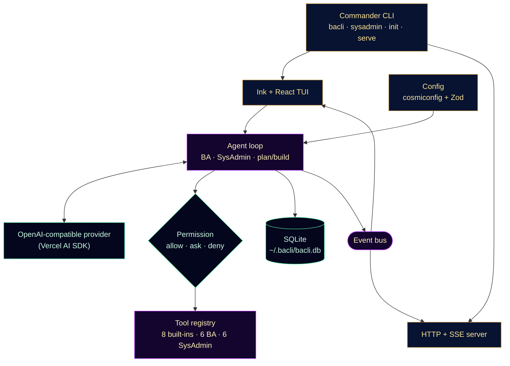

<p align="center">
  
</p>

<p align="center">
  
</p>

<p align="center">
  
  
  <a href="LICENSE"></a>
  
</p>

**bacli** is an AI agent that runs in your terminal. It has two modes. The **BA agent** writes requirements documents, diagrams, spreadsheets and SQL analysis. The **SysAdmin agent** writes Dockerfiles, Kubernetes manifests, Terraform and scripts, and can run commands over SSH. It uses an Ink + React TUI, works with any OpenAI-compatible model endpoint, checks a per-tool permission rule before every action, and stores sessions in a local SQLite database.

<p align="center"><sub><code>TYPESCRIPT</code> ✦ <code>INK TUI</code> ✦ <code>AI SDK</code> ✦ <code>OPENAI-COMPATIBLE</code> ✦ <code>SQLITE</code> ✦ <code>MIT</code></sub></p>

<h2 align="center">✦ TWO AGENTS, ONE TOOL ✦</h2>
<p align="center"><sub>PRESS <code>TAB</code> TO SWITCH</sub></p>

<table>
  <tr>
    <th width="50%">🎯 BA agent <sub>(default)</sub></th>
    <th width="50%">⚡ SysAdmin agent <sub>(<code>bacli sysadmin</code>)</sub></th>
  </tr>
  <tr>
    <td valign="top">
      📄 <b>document</b> — DOCX, PDF or Markdown output with no watermarks<br>
      📊 <b>spreadsheet</b> — multi-sheet Excel workbooks<br>
      🧭 <b>diagram</b> — Mermaid flowchart, sequence, ERD, class, Gantt and pie<br>
      🧩 <b>template</b> — BRD, FRD, user story, acceptance criteria, meeting notes, RACI, SWOT and status report<br>
      📈 <b>dataAnalysis</b> — CSV/JSON summary stats, columns and trends<br>
      🗄️ <b>sql</b> — generate, explain, analyze or optimize queries
    </td>
    <td valign="top">
      🐳 <b>docker</b> — Dockerfile and docker-compose.yml<br>
      ☸️ <b>k8s</b> — Deployment, Service, ConfigMap and other manifests<br>
      🌍 <b>terraform</b> — main.tf, variables.tf and outputs.tf<br>
      📜 <b>scriptGen</b> — Bash, PowerShell, Python and Batch scripts<br>
      🔐 <b>ssh</b> — remote commands (set to <code>ask</code> by default)<br>
      🌐 <b>network</b> — ping, traceroute, DNS, port checks and config generation
    </td>
  </tr>
  <tr>
    <td colspan="2" align="center"><sub>Both agents also get <code>bash</code> · <code>read</code> · <code>write</code> · <code>edit</code> (9 match strategies) · <code>glob</code> · <code>grep</code> · <code>webfetch</code> · <code>websearch</code></sub></td>
  </tr>
</table>

<h2 align="center">◈ HIGHLIGHTS ◈</h2>
<p align="center"><sub>WHAT THE AGENT LOOP GIVES YOU</sub></p>

<table>
  <tr>
    <td width="33%" valign="top">🛡️ <b>Permission rules</b><br><sub>Each tool resolves to <code>allow</code>, <code>ask</code> or <code>deny</code>. Glob patterns let you write rules like <code>*.env → ask</code>, and you can override rules per agent.</sub></td>
    <td width="33%" valign="top">🧠 <b>Memory files</b><br><sub>The agents are told to read and update <code>.bacli/memory.md</code> (project) and <code>~/.config/bacli/memory.md</code> (global).</sub></td>
    <td width="33%" valign="top">♻️ <b>Auto-compaction</b><br><sub>When a session reaches about 80% of the context window, it is forked with a summary so the conversation can continue.</sub></td>
  </tr>
  <tr>
    <td valign="top">🗂️ <b>Sessions</b><br><sub>Sessions are saved to SQLite at <code>~/.bacli/bacli.db</code>. Press <code>Ctrl+P</code> to browse them and fork or switch.</sub></td>
    <td valign="top">📝 <b>Plan / build modes</b><br><sub>Type <code>/plan</code> to talk it through without tool calls, then <code>/build</code> to let the agent act.</sub></td>
    <td valign="top">📡 <b>HTTP + SSE server</b><br><sub><code>bacli serve</code> streams agent events and serves session APIs for other front ends.</sub></td>
  </tr>
</table>

<h2 align="center">◆ QUICK START ◆</h2>
<p align="center"><sub>NODE.JS 20+ AND GIT REQUIRED</sub></p>

The installers clone the repo, build it and `npm link` the `bacli` command. As [SECURITY.md](SECURITY.md) advises, **read a script before you pipe it to a shell.**

```bash
# macOS / Linux
curl -fsSL https://raw.githubusercontent.com/kamikaze1120/BACLI/main/install.sh | bash
```

```powershell
# Windows (PowerShell)
irm https://raw.githubusercontent.com/kamikaze1120/BACLI/main/install.ps1 | iex
```

Or install by hand:

```bash
git clone https://github.com/kamikaze1120/BACLI.git
cd BACLI
npm install
npm run build
npm link          # puts `bacli` on your PATH
```

Point it at a model you control, then start:

```bash
export BACLI_API_KEY=...            # your provider key
export BACLI_BASE_URL=https://...   # any OpenAI-compatible endpoint
export BACLI_MODEL=your-model-id

bacli                                                   # BA agent
bacli "Create a BRD for a customer portal"              # BA agent with a first prompt
bacli sysadmin "Docker Compose for Node.js + Postgres"  # SysAdmin agent
```

<details>
<summary><b>📋 All commands and keys</b></summary>

<br>

```text
Usage: bacli [options] [prompt]

Arguments:
  prompt                     Initial prompt for the BA agent

Options:
  -V, --version              Output version number
  -m, --model <model>        Model ID to use
  -p, --provider <provider>  Provider name
  -h, --help                 Display help

Commands:
  sysadmin [prompt]          Start the System Administrator agent (-m supported)
  init                       Create .baclirc.json in the current directory
  serve [--port 4096]        Start the HTTP + SSE server
```

| Key / input | Action |
|---|---|
| `Tab` | Switch between the BA and SysAdmin agents |
| `Ctrl+P` | Open or close the session picker |
| `Ctrl+C` | Exit |
| `/plan` · `/build` | Talk only (no tools) · act with tools |

</details>

<h2 align="center">✦ CONFIGURATION ✦</h2>
<p align="center"><sub>COSMICONFIG + ZOD, LAYERED</sub></p>

Settings are merged in this order, with later layers winning: **built-in defaults → global file in your home directory** (`.baclirc.json` or `bacli.config.json`) **→ project file** (`.baclirc`, `.baclirc.json`, `bacli.config.{json,js,ts}` or a `bacli` key in `package.json`) **→ environment variables → CLI flags**. `bacli init` writes a starter `.baclirc.json`. An `apiKey` written as `"${VAR}"` is read from that environment variable.

| Env var | Overrides |
|---|---|
| `BACLI_API_KEY` | `apiKey` |
| `BACLI_BASE_URL` | `baseUrl` |
| `BACLI_MODEL` | `model` |
| `BACLI_PROVIDER` | `provider` |
| `GOOGLE_API_KEY` + `GOOGLE_CX` | Optional. `websearch` uses Google Custom Search, otherwise the DuckDuckGo Instant Answer API |

<details>
<summary><b>🧾 Example <code>.baclirc.json</code></b></summary>

<br>

```json
{
  "model": "your-model-id",
  "provider": "your-provider",
  "baseUrl": "https://your-openai-compatible-endpoint/v1",
  "apiKey": "${MY_PROVIDER_API_KEY}",
  "shell": "bash",
  "logLevel": "INFO",
  "agent": {
    "ba":       { "permission": { "edit": "allow", "bash": "ask",   "read": "allow" } },
    "sysadmin": { "permission": { "edit": "allow", "bash": "allow", "ssh":  "ask"   } }
  },
  "permission": {
    "read": { "*.env": "ask", "*.env.*": "ask", "*.key": "deny" }
  },
  "toolOutput": { "maxLines": 200, "maxBytes": 8192 },
  "compaction": { "auto": true, "tailTurns": 15 }
}
```

Default permissions: the BA agent can edit files but must `ask` before running `bash`. The SysAdmin agent can run `bash` but must `ask` before using `ssh`. Reading any `*.env` file always prompts.

</details>

<h2 align="center">◈ ARCHITECTURE ◈</h2>
<p align="center"><sub>ONE AGENT LOOP, THREE FRONT DOORS</sub></p>



<details>
<summary><b>📡 Server endpoints</b> (<code>bacli serve</code>, default port 4096)</summary>

<br>

| Method | Path | Returns |
|---|---|---|
| `GET` | `/events` (alias `/global/event`) | SSE stream: `log`, `text:delta`, `tool:status`, `permission:request`, `session` |
| `GET` | `/sessions` | Session list |
| `GET` | `/sessions/:id` | Messages for a session |
| `GET` | `/health` | `{ status, timestamp }` |
| `POST` | `/permission/response` | Answers a pending `ask` permission |

The server sends permissive CORS headers and has **no authentication**. Keep it on localhost unless you add your own access controls (see [SECURITY.md](SECURITY.md)).

</details>

<h2 align="center">◆ TECH STACK ◆</h2>

<p align="center">
  
</p>

<p align="center"><sub>Vercel AI SDK v6 · Ink 5 · Commander · cosmiconfig · Zod v4 · better-sqlite3 · docx · pdf-lib · ExcelJS · Handlebars · ssh2 · Vitest</sub></p>

<h2 align="center">✦ DEVELOPMENT ✦</h2>

| Script | Does |
|---|---|
| `npm run dev` | Run from source with `tsx` |
| `npm run build` | Compile TypeScript into `dist/` |
| `npm start` | Run the compiled CLI |
| `npm test` | Vitest: 65 test cases across 5 suites (agent, config, edit, permissions, tools) |
| `npm run test:watch` | Vitest in watch mode |
| `npm run binary` | Package a standalone binary with `pkg` |

<details>
<summary><b>🗂️ Project structure</b></summary>

<br>

```text
BACLI/
├── src/
│   ├── index.ts            # Commander entry point
│   ├── agent/              # loop, permissions, compaction, ba-agent, sysadmin-agent
│   ├── config/             # Zod schema, defaults, cosmiconfig loader
│   ├── tools/
│   │   ├── builtins/       # bash, read, write, edit, glob, grep, webfetch, websearch
│   │   ├── ba/             # document, spreadsheet, diagram, template, data-analysis, sql
│   │   └── sysadmin/       # ssh, script-gen, docker, k8s, terraform, network
│   ├── bus/event-bus.ts    # global event bus
│   ├── storage/            # SQLite init + session/message CRUD
│   └── cli/
│       ├── tui/            # Ink + React app and theme
│       └── server/         # HTTP + SSE server
├── tests/                  # Vitest suites
├── install.sh · install.ps1
├── SECURITY.md · AGENTS.md · LICENSE
└── package.json
```

</details>

<details>
<summary><b>🗑️ Uninstall</b></summary>

<br>

```bash
npm unlink -g @bacli/cli          # remove the linked `bacli` command
rm -rf ~/.bacli                   # installed source (install.sh) + sessions database
rm -rf ~/.config/bacli            # global memory file
rm -rf .bacli                     # per-project memory, inside a project
```

On Windows, `install.ps1` clones to `%LOCALAPPDATA%\bacli`. Sessions are stored in `%USERPROFILE%\.bacli`.

</details>

<h2 align="center">◈ SAFE OPERATION ◈</h2>
<p align="center"><sub>POWERFUL TOOLS, YOUR RULES</sub></p>

bacli can run shell commands, edit files and reach remote hosts with whatever credentials its process has. Start with `ask` or `deny` for `bash`, `write`, `ssh` and infrastructure changes. Work inside a version-controlled workspace. Review any generated Terraform, manifests and scripts before you apply them. Keep keys out of prompts and committed config. Full checklist: **[SECURITY.md](SECURITY.md)**.

<h2 align="center">◆ LICENSE ◆</h2>

<p align="center">MIT — see <a href="LICENSE">LICENSE</a>. Contributions welcome: branch, add tests, run <code>npm test</code>, open a PR.</p>

<p align="center">
  <sub><code>◉ DOCS AND INFRA FROM THE PROMPT // GILDED ORBIT</code></sub><br>
  <sub>Built by <a href="https://github.com/kamikaze1120">@kamikaze1120</a></sub>
</p>
